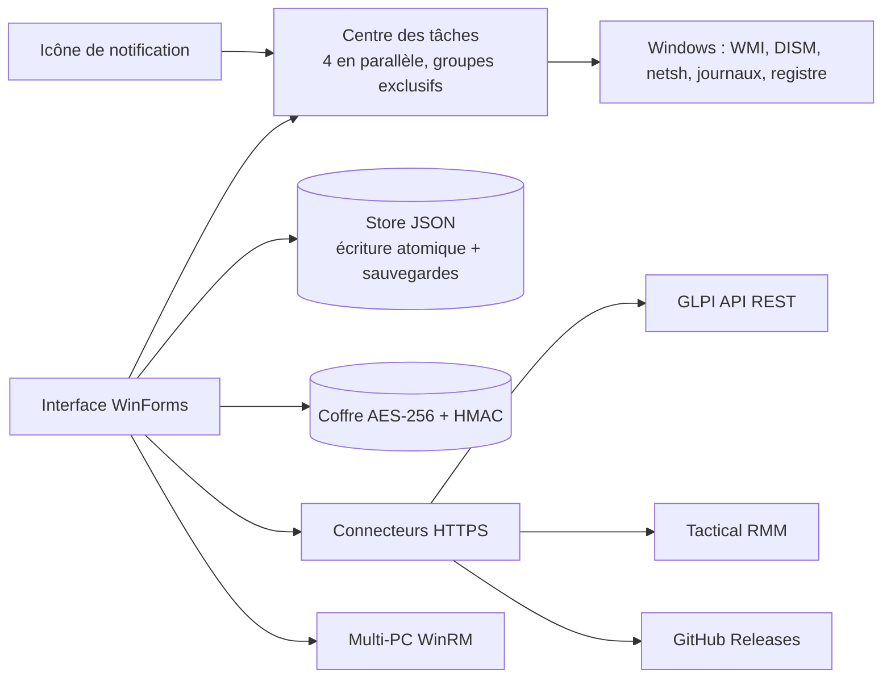

# Tech IT AB et PC Santé AB

[](https://github.com/alexisbouchet6-del/tech-it-ab/actions/workflows/ci.yml)

Développé by alex.b

Deux applications Windows compilées à partir du même code :

| Édition | Public | Contenu |
|---|---|---|
| **Tech IT AB** | Le technicien (usage interne, labos) | Console complète : clients et parc, interventions, GLPI et Tactical RMM, diagnostic et dépannage, réseau, coffre chiffré, Multi-PC, Active Directory, secours, **cyber** (scans Nmap encadrés, chasse aux menaces, labo défensif). Remplace AMI·OPS et reprend ses données. |
| **PC Santé AB** | Le client, pour son propre poste | Santé et dépannage du PC uniquement : optimisation, PanneScan, dépannage, sécurité du poste, diagnostic réseau, appareils du réseau local (sans test de ports), page Jeu, scénarios, outils. |

**Cloisonnement.** PC Santé AB est compilé avec le symbole `POSTE` à partir d'une liste blanche de fichiers : le code de Nmap, des clients, du parc, de GLPI, du coffre, du Multi-PC, de l'Active Directory et du secours n'est pas masqué, il est **absent de l'exécutable**. La CI le vérifie à chaque compilation (inspection des types de `PCSanteAB.exe`).

**Protection « sous mon nom ».** Au démarrage, chaque édition vérifie sa propre signature Authenticode contre l'empreinte épinglée d'alex.b (`Ed.SignThumb`). Une copie modifiée, recompilée ou re-signée par un tiers passe en « copie non autorisée » : bandeau d'avertissement et désactivation des fonctions sensibles (Cyber, labo, supervision). C'est un garde-fou qui détecte et bride une copie trafiquée — il ne rend pas le binaire inviolable ; la protection réelle reste la signature du certificat et le dépôt source privé.

## Sommaire

- [Fonctionnalités](#fonctionnalités)
- [Prérequis](#prérequis)
- [Installation](#installation)
- [Utilisation](#utilisation)
- [Compilation](#compilation)
- [Architecture](#architecture)
- [Modèle de menace](#modèle-de-menace)
- [Limites connues](#limites-connues)

## Fonctionnalités

| Domaine | Contenu |
|---|---|
| Clients et interventions | Fiches clients (contacts, parc), interventions chronométrées, rapport, suivi du temps, ticket GLPI en un clic |
| Centre des tâches | Jusqu'à 4 actions en parallèle, avec exclusion automatique des actions incompatibles (Windows Update, réseau, spouleur, antivirus, indexation) ; l'annulation arrête le programme en cours et ses processus enfants |
| Scénarios | Enchaînements prêts à l'emploi : PC lent, écran bleu, PC neuf, problème réseau, prêt à jouer, fin d'intervention ; Tech IT AB crée l'intervention correspondante, PC Santé AB enregistre un rapport texte (sans PC neuf ni fin d'intervention) |
| Optimisation | Bilan noté sur 10 par élément (mises à jour, pilotes, démarrage, disque, sécurité, performances) avec préconisations ; nettoyage, mises à jour Windows, gestion du démarrage |
| Dépannage | Réparations courantes (DISM/SFC, spouleur, Windows Update, Outlook en mode sans échec, réseau), analyse des écrans bleus, PanneScan des journaux |
| Réseau | Diagnostic, surveillance Wi-Fi, débit, DHCP, test SMTP, scan du parc (ScanParc), vérification d'un domaine mail (MailCheck) |
| Sécurité | Audit noté avec correctifs proposés (dont version de Windows 11 26H2), état de l'antivirus |
| Serveur AD | Opérations courantes Active Directory |
| Jeu (les deux éditions) | Analyse notée sur 100 (pilote graphique, fréquence et branchement de l'écran, mémoire simple canal ou sans XMP/EXPO, Mode Jeu, enregistrement en arrière-plan, HAGS, alimentation, souris, Visual C++, jeux sur disque dur, applis ouvertes), optimisations réversibles avec point de restauration, session de jeu (fermeture propre des applis inutiles puis réouverture sans droits administrateur), fréquence maximale de l'écran avec retour automatique, pilotes, détection des possibilités d'overclocking (jamais appliqué), bibliothèque Steam/Epic, carte graphique par jeu, latence, composants et outils officiels via winget |
| Protection (les deux éditions) | Contrôle d'authenticité au démarrage (WinVerifyTrust + empreinte épinglée) : authentique / non signée / altérée ; une copie non authentique est bridée (Cyber, labo, supervision coupés) et affiche un bandeau |
| Supervision (opt-in) | PC Santé AB enrôlé par code client envoie un état technique à l'endpoint d'inventaire GLPI d'alex.b **sans jeton d'admin** (modèle agent GLPI), avec bandeau « poste supervisé » ; Tech IT AB relit les postes supervisés dans « Parc client » |
| Renforts cyber (Tech IT AB) | Sysmon (installation winget + config de journalisation fine, lecture des événements à risque classés MITRE : injection T1055, LSASS T1003, PowerShell encodé, persistance), Autoruns (démarrage complet, signatures, VirusTotal), audit de durcissement CIS Benchmark / ANSSI (~20 points, note /100, remédiation, références) |
| Cyber (Tech IT AB) | Scans Nmap limités au périmètre autorisé de chaque client (autorisation écrite datée, journal des scans, scripts offensifs refusés), règles de risque ANSSI/CIS/MITRE, comparaison entre scans, chasse aux menaces dans les journaux, persistance, connexions, mot de passe compromis (k-anonymat), fichier suspect (VirusTotal par empreinte), rapport PDF |
| Labo défensif (Tech IT AB) | Analyse d'e-mail (hameçonnage), analyse de lien (IP loggers, sosies de domaines) sans l'ouvrir, détection des scans de ports reçus (journal du pare-feu), durcissement anti-scan réversible, test de sécurité d'un programme (signature, ASLR, DEP, CFG) et comportement avant/après |
| Parc client (projet GLPI) | Recette de livraison (rapport du kit USB, nommage, licences, BitLocker, agents GLPI et Tactical RMM, Kaspersky, mises à jour), PV signé envoyé dans GLPI, enrôlement d'un PC existant, état du parc par client, rapport mensuel de conformité, NAS → GLPI, tickets GLPI (suivi, tâche avec temps, résolution) |
| Multi-PC | Exécution d'une action sur plusieurs postes via WinRM (atelier, domaine) ou via Tactical RMM (postes des clients, sans port ouvert) |
| Connecteurs | GLPI (API REST v1 : entités, ordinateurs, agents, disques, antivirus, tickets, documents) et Tactical RMM (agents, commandes) ; santé des serveurs (HTTPS, expiration des certificats) |
| Outils intégrés | DiagPoste, MaintenancePC, PrépaPoste, ProfilSave, TestReseau, ScanParc, MailCheck, TriFichiers, Rapport d'intervention, NasConnect, NetSwitch, Outils VTx, PowerMenu |
| Icône de notification | Chronomètre, tâches, scénarios, bascule réseau rapide, VT-x, NAS ; démarrage automatique optionnel |
| Coffre | Mots de passe chiffrés (AES-256-CBC + HMAC-SHA256, clé dérivée par PBKDF2-SHA256, 300 000 itérations) |
| Autotest | Vérification intégrée en lecture seule (bouton dans Paramètres ou ligne de commande) |
| Mise à jour | Vérification quotidienne des versions publiées sur GitHub, contrôle SHA-256 et, si configurée, de l'empreinte du certificat de signature |
| Secours | Création d'une clé USB WinPE de secours (`suite/AmiOps/cle-secours`), script de diagnostic macOS (`suite/AmiOps/mac`) |

## Prérequis

- Windows 10 ou Windows 11, 64 bits.
- .NET Framework 4.8 (présent par défaut sur Windows 10 1903 et ultérieur, et sur Windows 11).
- Droits administrateur (l'application demande l'élévation au lancement).
- Optionnel : WinRM activé sur les postes cibles pour la fonction Multi-PC ; URL HTTPS et jetons d'API pour GLPI et Tactical RMM.

## Installation

1. Téléchargez `TechITAB-portable.exe` (ou `PCSanteAB-portable.exe`) et `SHA256SUMS.txt` depuis la page [Releases](https://github.com/alexisbouchet6-del/tech-it-ab/releases).
2. Vérifiez l'empreinte :
   ```powershell
   (Get-FileHash .\TechITAB-portable.exe -Algorithm SHA256).Hash
   ```
   La valeur doit correspondre à la ligne du fichier de `SHA256SUMS.txt`.
3. Lancez l'exécutable. Si l'exécutable n'est pas signé, Windows SmartScreen affiche un avertissement : « Informations complémentaires » puis « Exécuter quand même ».

Les installateurs NSIS (`suite/AmiOps/installer/TechITAB.nsi`, `PCSanteAB.nsi`) installent l'application dans `C:\Program Files\TechITAB` ou `C:\Program Files\PCSanteAB`. Le Setup de Tech IT AB désinstalle AMI·OPS ; ses données sont reprises au premier lancement.

Les scans réseau de Tech IT AB nécessitent Nmap, à installer depuis [nmap.org](https://nmap.org/download) : sa licence gratuite interdit de l'intégrer à un logiciel propriétaire.

## Utilisation

| Action | Commande ou emplacement |
|---|---|
| Palette de commandes | `Ctrl+K` dans l'application |
| Démarrage réduit dans la zone de notification | `TechITAB.exe --tray` |
| Autotest complet (lecture seule) | `TechITAB.exe --selftest rapport.txt` |
| Autotest d'intégration continue | `TechITAB.exe --selftest-ci rapport.txt` (code de sortie = nombre d'échecs) |
| Données | `%LOCALAPPDATA%\TechITAB\donnees` (`PCSanteAB` pour l'édition poste) du compte administrateur qui lance l'application (modifiable dans Paramètres, par exemple vers un partage NAS), sauvegardes quotidiennes conservées 60 jours |

Exemple de vérification après installation :

```powershell
Start-Process .\TechITAB.exe -ArgumentList '--selftest-ci', 'autotest.txt' -Wait -PassThru | Select-Object ExitCode
Get-Content .\autotest.txt
```

## Compilation

### Sous Windows (compilateur Microsoft)

Prérequis : Visual Studio 2022 Build Tools avec la charge de travail « Développement .NET Desktop ».

```powershell
pwsh -File build/build.ps1          # exécutables dans out\ + SHA256SUMS.txt
pwsh -File build/build.ps1 -Tests   # en plus : bancs T15 (page Jeu) des deux éditions, out\T15-*.exe
pwsh -File build/selftest.ps1       # autotest, code de sortie = nombre d'échecs
```

### Tests des connecteurs (Linux, Mono)

`tests/ParcTests.cs` vérifie la recette, l'état du parc, le canal Tactical RMM, l'envoi de documents et l'annulation des tâches contre de faux serveurs GLPI et Tactical RMM (`tests/fake_glpi_trmm.py`, HTTPS auto-signé).

```bash
cd tests && openssl req -x509 -newkey rsa:2048 -nodes -keyout key.pem -out cert.pem -days 10 -subj "/CN=127.0.0.1"
python3 fake_glpi_trmm.py 8443 &
# compiler ParcTests.cs avec les sources (voir suite/AmiOps/build-editions.sh, -main:AmiOps.T13 ou -main:AmiOps.T14 + -r:System.Xml) puis : mono t13.exe ; mono t14.exe (vrai Nmap requis)
```

`tests/DefenseTests.cs` (T17, `-main:AmiOps.T17`) vérifie la logique pure des renforts cyber : découpe CSV d'Autoruns, évaluation des entrées de démarrage, évaluation du durcissement CIS/ANSSI (note, remédiation) et mapping des événements Sysmon.

`tests/SupervTests.cs` (T16, `-main:AmiOps.T16`) vérifie le contrôle d'authenticité (décision pure, états), la validation et la construction de l'inventaire GLPI tokenless, et un aller-retour envoi/relecture contre le faux serveur (route `/front/inventory.php`).

`tests/GameTests.cs` (T15, `-main:AmiOps.T15`) vérifie les règles de la page Jeu : reconnaissance des cartes graphiques, version NVIDIA, overclocking possible ou non, mémoire, bibliothèque Steam, liste des processus jamais fermés, note, liste blanche de restauration (lignes trafiquées ignorées), optimisation puis annulation dans le registre. Il se compile pour chaque édition et tourne aussi sur Windows en CI.

### Sous Linux (Mono)

```bash
sudo apt-get install -y mono-devel nsis
bash suite/AmiOps/build-editions.sh        # Tech IT AB + PC Santé AB
cd suite && bash build.sh DiagPoste System.Management   # une appli de la suite
```

### Intégration continue

Le workflow `.github/workflows/ci.yml` s'exécute à chaque push et pull request :

1. recherche de secrets (gitleaks) dans les commits poussés ;
2. compilation sur `windows-latest` avec le compilateur Roslyn ;
3. bancs T15 (page Jeu), T16 (authenticité, inventaire) et T17 (renforts cyber) puis autotest des deux éditions sur un vrai Windows, et vérification du cloisonnement de PC Santé AB ;
4. analyse PowerShell (PSScriptAnalyzer) ;
5. sur un tag `v*` : signature (si les secrets `SIGN_PFX_BASE64` et `SIGN_PFX_PASSWORD` sont définis), empreintes SHA-256 et publication de la version.

Publier une version :

```bash
git tag v1.7.0 && git push origin v1.7.0
```

## Architecture

```
tech-it-ab/
├── build/                 scripts de compilation et d'autotest Windows
├── .github/               CI, Dependabot
├── suite/
│   ├── common/Cyber.cs    socle commun (thème, journal, configuration, durcissement)
│   ├── AmiOps/src/        les deux éditions (Edition.cs, Shell, Pages, Jobs, Tray, Remote, Parc, CyberPage, Labo, PosteHome…)
│   ├── <Appli>/src/       les dix applis de la suite, compilables seules ou intégrées
│   └── package.py, mkapp.py, build.sh
└── legacy/                NetSwitch, Outils VTx, PowerMenu et leur socle (Harden.cs)
```



Choix techniques :

- **.NET Framework 4.8 / WinForms** : présent sur tous les postes Windows 10/11 des clients, aucun runtime à déployer, un seul exécutable portable.
- **Un seul processus élevé** : les réparations système exigent les droits administrateur. Les actions qui doivent s'exécuter dans le contexte de l'utilisateur (Outlook, lecteurs réseau) passent par `runas /trustlevel:0x20000` et le paramètre `EnableLinkedConnections`.
- **Centre des tâches avec groupes exclusifs** : deux actions qui se gênent (deux opérations Windows Update, par exemple) ne s'exécutent jamais en même temps, sans bloquer les autres.
- **Stockage JSON local** : lisible, sauvegardable, sans service de base de données ; écriture atomique (`File.Replace`) et copie de conflit si le fichier a été modifié par un autre poste.

## Modèle de menace

| Actif | Point d'entrée | Menace | Mesure |
|---|---|---|---|
| Mots de passe clients (coffre) | Fichier `coffre.json` | Vol du fichier, altération | AES-256-CBC + HMAC-SHA256 (chiffrer puis authentifier), PBKDF2-SHA256 300 000 itérations, mot de passe maître jamais stocké |
| Jetons GLPI / Tactical RMM | Paramètres | Vol de jeton, interception | Chiffrement DPAPI lié au compte Windows, HTTPS obligatoire, jetons jamais journalisés |
| Identifiants Multi-PC | Saisie à la volée | Exposition en ligne de commande ou sur disque | Mot de passe transmis par l'entrée standard, jamais écrit sur disque ni passé en argument |
| Mise à jour automatique | GitHub Releases | Binaire piégé, compte GitHub compromis | Contrôle SHA-256 obligatoire (intégrité du transfert), signature Authenticode valide et empreinte du certificat épinglable (authenticité : seule protection contre un compte GitHub compromis), HTTPS uniquement |
| Poste du technicien | Exécutable élevé | Détournement de DLL, remplacement de fichier par un processus non élevé | `DefaultDllImportSearchPaths(System32)` et `SetDllDirectory("")`, mise à jour préparée dans un dossier neuf réservé à SYSTEM et aux Administrateurs, instance unique |
| Réseaux des clients | Scans Nmap | Scan non autorisé, détournement de l'outil | Périmètre par client + autorisation écrite datée (12 mois), refus hors périmètre (noms résolus et vérifiés avant Nmap), plus de 65 536 adresses refusées, profils fixes, scripts offensifs refusés, journal `cyber-audit.log` |
| Postes des clients | PC Santé AB | Usage malveillant par un tiers | Fonctions sensibles absentes de l'exécutable (compilation par liste blanche), découverte réseau sans test de ports, aucune donnée stockée |
| Outils Sysinternals (Sysmon, Autoruns) | Poste audité | Binaire tiers non maîtrisé embarqué dans l'exe signé | Installés depuis winget (dépôt Microsoft), jamais embarqués ni téléchargés hors winget ; configuration Sysmon écrite en clair dans le dépôt |
| Intégrité de l'exe | Copie distribuée | Modification / rebranding via une IA, re-signature par un tiers | Contrôle Authenticode au démarrage (WinVerifyTrust) contre l'empreinte épinglée ; copie non authentique bridée. Garde-fou (contournable par un RE déterminé), pas une protection inviolable : signature du certificat + source privée |
| Supervision des postes clients | GLPI (inventaire) | Fuite du jeton d'admin GLPI via l'exe client | L'exe client ne contient AUCUN jeton : il poste sur l'endpoint d'inventaire tokenless (tag = code client), comme un agent GLPI ; le jeton d'admin reste sur la machine d'alex.b (DPAPI) pour la relecture seule. Opt-in et visible du client (RGPD) |
| Mot de passe testé | Have I Been Pwned | Fuite du mot de passe | k-anonymat : 5 caractères de l'empreinte SHA-1 envoyés, réponse avec bourrage |
| Réglages du PC (page Jeu) | Sauvegarde des valeurs d'origine dans `config.ini`, modifiable par l'utilisateur alors que l'appli tourne en administrateur | Écriture détournée dans le registre ou lancement de commandes à la restauration | Liste blanche stricte : 6 valeurs de registre nommées (seule `HwSchMode` en HKLM, valeurs 0 à 2), plans d'alimentation Windows connus, préférences GPU limitées à des chemins `.exe` validés ; toute autre ligne est ignorée |
| Applis fermées (session de jeu) | Liste des applis à rouvrir | Lancement d'un programme avec les droits administrateur | Relance par l'Explorateur, donc avec les droits de l'utilisateur connecté ; chemins `.exe` existants uniquement |
| Données clients | `amiops.json` | Fuite via le dépôt Git | Données hors du dépôt (`%LOCALAPPDATA%`), `.gitignore`, scan gitleaks en CI |
| Clés BitLocker | Séquestre à la livraison | Lecture par tout technicien ayant accès à GLPI | Clé stockée uniquement dans le coffre chiffré ; GLPI ne reçoit que l'identifiant de la clé (dans le PV) |
| Lien de déploiement Tactical RMM | Enrôlement | Installation d'agents non autorisés | Stocké chiffré (DPAPI) par client, https et domaine du serveur Tactical RMM imposés |
| GLPI Agent | Enrôlement | MSI piégé | Dernière version GitHub acceptée uniquement si son empreinte SHA-256 publiée (champ `digest`) correspond ; sinon MSI local fourni par le technicien |
| Commandes système | Saisies utilisateur | Injection de commande | Validation des saisies (adresses, noms d'hôte, chemins), arguments construits sans concaténation de texte libre là où c'est possible |

Fichiers à ne jamais pousser : certificats (`*.pfx`), `.env`, fichiers de données (`amiops*.json`, `coffre*.json`), journaux. Le secret de signature se configure uniquement dans les secrets GitHub du dépôt.

## Limites connues

- Enrôlement : le mot de passe du compte des agents GLPI est transmis à `msiexec` en ligne de commande, comme le prévoit l'installateur de GLPI Agent ; il est visible des administrateurs locaux pendant l'installation.

- Les fonctions dépendantes de Windows (WMI, journaux d'événements, Windows Update, Defender, réparations, Active Directory, WinRM, connecteurs) sont validées par l'autotest en CI et par les essais sur poste réel ; elles ne sont pas exécutables sous Mono.
- L'exécutable n'est signé que si un certificat de signature de code est configuré.
- Page Jeu : la lecture du matériel (cartes graphiques, écrans, mémoire, carte mère) passe par WMI et l'API Win32 ; elle est testée en CI sur un Windows sans carte graphique ni Steam. Le comportement sur un PC de jeu réel (NVIDIA, AMD, Intel Arc, écran 144 Hz) reste à valider sur poste.
- L'overclocking n'est jamais appliqué par l'application, volontairement : AMD et Intel excluent de la garantie les dommages hors spécifications.
- L'interface fonctionne avec un seul processus administrateur ; une séparation interface standard / moteur administrateur n'est pas implémentée.

## Licence

Propriétaire — voir [LICENSE](LICENSE).
