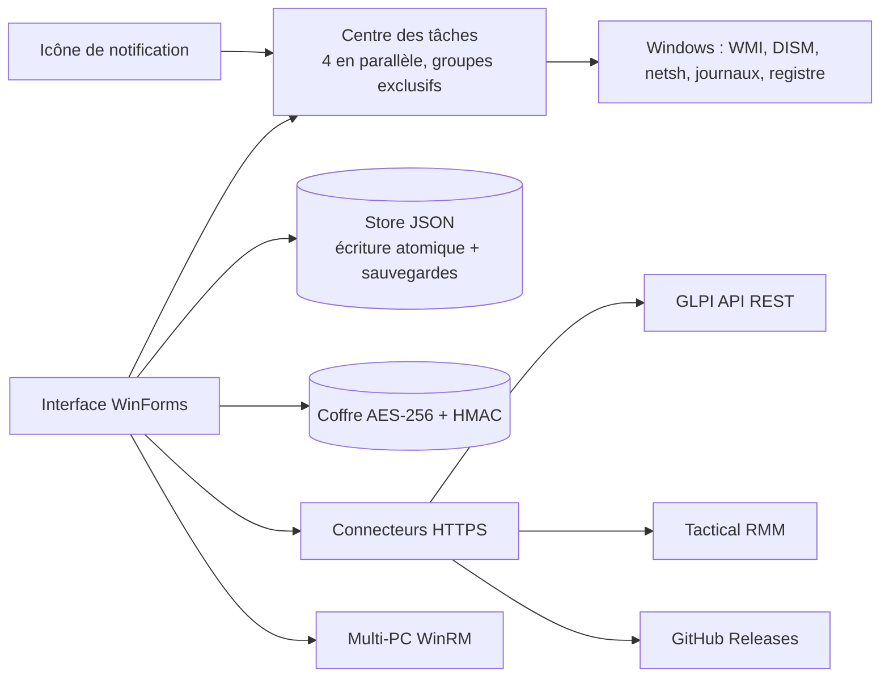

# AMI·OPS — console du technicien

[](https://github.com/alexisbouchet6-del/amiops/actions/workflows/ci.yml)

Développé by alex.b

AMI·OPS est une application Windows (.exe unique) qui regroupe l'ensemble des outils d'intervention d'un technicien informatique : suivi des clients et des interventions, diagnostic et optimisation du poste, dépannage, réseau, sécurité, Active Directory, coffre de mots de passe chiffré, actions sur plusieurs PC et connexion à GLPI et Tactical RMM. Les treize outils de la suite « by alex.b » sont intégrés dans le même exécutable.

## Sommaire

- [Fonctionnalités](#fonctionnalités)
- [Prérequis](#prérequis)
- [Installation](#installation)
- [Utilisation](#utilisation)
- [Compilation](#compilation)
- [Architecture](#architecture)
- [Modèle de menace](#modèle-de-menace)
- [Limites connues](#limites-connues)

## Fonctionnalités

| Domaine | Contenu |
|---|---|
| Clients et interventions | Fiches clients (contacts, parc), interventions chronométrées, rapport, suivi du temps, ticket GLPI en un clic |
| Centre des tâches | Jusqu'à 4 actions en parallèle, avec exclusion automatique des actions incompatibles (Windows Update, réseau, spouleur, antivirus, indexation) ; l'annulation arrête le programme en cours et ses processus enfants |
| Scénarios | Enchaînements prêts à l'emploi : PC lent, écran bleu, PC neuf, problème réseau, fin d'intervention ; chaque scénario crée l'intervention correspondante |
| Optimisation | Bilan noté sur 10 par élément (mises à jour, pilotes, démarrage, disque, sécurité, performances) avec préconisations ; nettoyage, mises à jour Windows, gestion du démarrage |
| Dépannage | Réparations courantes (DISM/SFC, spouleur, Windows Update, Outlook en mode sans échec, réseau), analyse des écrans bleus, PanneScan des journaux |
| Réseau | Diagnostic, surveillance Wi-Fi, débit, DHCP, test SMTP, scan du parc (ScanParc), vérification d'un domaine mail (MailCheck) |
| Sécurité | Audit noté avec correctifs proposés (dont version de Windows 11 26H2), état de l'antivirus |
| Serveur AD | Opérations courantes Active Directory |
| Parc client (projet GLPI) | Recette de livraison (rapport du kit USB, nommage, licences, BitLocker, agents GLPI et Tactical RMM, Kaspersky, mises à jour), PV signé envoyé dans GLPI, enrôlement d'un PC existant, état du parc par client, rapport mensuel de conformité, NAS → GLPI, tickets GLPI (suivi, tâche avec temps, résolution) |
| Multi-PC | Exécution d'une action sur plusieurs postes via WinRM (atelier, domaine) ou via Tactical RMM (postes des clients, sans port ouvert) |
| Connecteurs | GLPI (API REST v1 : entités, ordinateurs, agents, disques, antivirus, tickets, documents) et Tactical RMM (agents, commandes) ; santé des serveurs (HTTPS, expiration des certificats) |
| Outils intégrés | DiagPoste, MaintenancePC, PrépaPoste, ProfilSave, TestReseau, ScanParc, MailCheck, TriFichiers, Rapport d'intervention, NasConnect, NetSwitch, Outils VTx, PowerMenu |
| Icône de notification | Chronomètre, tâches, scénarios, bascule réseau rapide, VT-x, NAS ; démarrage automatique optionnel |
| Coffre | Mots de passe chiffrés (AES-256-CBC + HMAC-SHA256, clé dérivée par PBKDF2-SHA256, 300 000 itérations) |
| Autotest | Vérification intégrée en lecture seule (bouton dans Paramètres ou ligne de commande) |
| Mise à jour | Vérification quotidienne des versions publiées sur GitHub, contrôle SHA-256 et, si configurée, de l'empreinte du certificat de signature |
| Secours | Création d'une clé USB WinPE de secours (`suite/AmiOps/cle-secours`), script de diagnostic macOS (`suite/AmiOps/mac`) |

## Prérequis

- Windows 10 ou Windows 11, 64 bits.
- .NET Framework 4.8 (présent par défaut sur Windows 10 1903 et ultérieur, et sur Windows 11).
- Droits administrateur (l'application demande l'élévation au lancement).
- Optionnel : WinRM activé sur les postes cibles pour la fonction Multi-PC ; URL HTTPS et jetons d'API pour GLPI et Tactical RMM.

## Installation

1. Téléchargez `AmiOps-portable.exe` et `SHA256SUMS.txt` depuis la page [Releases](https://github.com/alexisbouchet6-del/amiops/releases).
2. Vérifiez l'empreinte :
   ```powershell
   (Get-FileHash .\AmiOps-portable.exe -Algorithm SHA256).Hash
   ```
   La valeur doit correspondre à la ligne `AmiOps-portable.exe` de `SHA256SUMS.txt`.
3. Lancez l'exécutable. Si l'exécutable n'est pas signé, Windows SmartScreen affiche un avertissement : « Informations complémentaires » puis « Exécuter quand même ».

L'installateur NSIS (`suite/AmiOps/installer`) installe l'application dans `C:\Program Files\AmiOps`, crée les raccourcis et l'entrée « Programmes et fonctionnalités ».

## Utilisation

| Action | Commande ou emplacement |
|---|---|
| Palette de commandes | `Ctrl+K` dans l'application |
| Démarrage réduit dans la zone de notification | `AmiOps.exe --tray` |
| Autotest complet (lecture seule) | `AmiOps.exe --selftest rapport.txt` |
| Autotest d'intégration continue | `AmiOps.exe --selftest-ci rapport.txt` (code de sortie = nombre d'échecs) |
| Données | `%LOCALAPPDATA%\AmiOps\donnees` du compte administrateur qui lance l'application (modifiable dans Paramètres, par exemple vers un partage NAS), sauvegardes quotidiennes conservées 60 jours |

Exemple de vérification après installation :

```powershell
Start-Process .\AmiOps.exe -ArgumentList '--selftest-ci', 'autotest.txt' -Wait -PassThru | Select-Object ExitCode
Get-Content .\autotest.txt
```

## Compilation

### Sous Windows (compilateur Microsoft)

Prérequis : Visual Studio 2022 Build Tools avec la charge de travail « Développement .NET Desktop ».

```powershell
pwsh -File build/build.ps1      # exécutables dans out\ + SHA256SUMS.txt
pwsh -File build/selftest.ps1   # autotest, code de sortie = nombre d'échecs
```

### Tests des connecteurs (Linux, Mono)

`tests/ParcTests.cs` vérifie la recette, l'état du parc, le canal Tactical RMM, l'envoi de documents et l'annulation des tâches contre de faux serveurs GLPI et Tactical RMM (`tests/fake_glpi_trmm.py`, HTTPS auto-signé).

```bash
cd tests && openssl req -x509 -newkey rsa:2048 -nodes -keyout key.pem -out cert.pem -days 10 -subj "/CN=127.0.0.1"
python3 fake_glpi_trmm.py 8443 &
# compiler ParcTests.cs avec les sources (voir suite/AmiOps/build-amiops.sh, -main:AmiOps.T13) puis : mono t13.exe
```

### Sous Linux (Mono)

```bash
sudo apt-get install -y mono-devel nsis
bash suite/AmiOps/build-amiops.sh          # AMI·OPS
cd suite && bash build.sh DiagPoste System.Management   # une appli de la suite
```

### Intégration continue

Le workflow `.github/workflows/ci.yml` s'exécute à chaque push et pull request :

1. recherche de secrets (gitleaks) dans les commits poussés ;
2. compilation sur `windows-latest` avec le compilateur Roslyn ;
3. autotest d'AMI·OPS sur un vrai Windows ;
4. analyse PowerShell (PSScriptAnalyzer) ;
5. sur un tag `v*` : signature (si les secrets `SIGN_PFX_BASE64` et `SIGN_PFX_PASSWORD` sont définis), empreintes SHA-256 et publication de la version.

Publier une version :

```bash
git tag v1.2.0 && git push origin v1.2.0
```

## Architecture

```
amiops/
├── build/                 scripts de compilation et d'autotest Windows
├── .github/               CI, Dependabot
├── suite/
│   ├── common/Cyber.cs    socle commun (thème, journal, configuration, durcissement)
│   ├── AmiOps/src/        console (Shell, Pages, Jobs, Tray, Remote, Optim, Depannage, NetDiag, Security…)
│   ├── <Appli>/src/       les dix applis de la suite, compilables seules ou intégrées
│   └── package.py, mkapp.py, build.sh
└── legacy/                NetSwitch, Outils VTx, PowerMenu et leur socle (Harden.cs)
```



Choix techniques :

- **.NET Framework 4.8 / WinForms** : présent sur tous les postes Windows 10/11 des clients, aucun runtime à déployer, un seul exécutable portable.
- **Un seul processus élevé** : les réparations système exigent les droits administrateur. Les actions qui doivent s'exécuter dans le contexte de l'utilisateur (Outlook, lecteurs réseau) passent par `runas /trustlevel:0x20000` et le paramètre `EnableLinkedConnections`.
- **Centre des tâches avec groupes exclusifs** : deux actions qui se gênent (deux opérations Windows Update, par exemple) ne s'exécutent jamais en même temps, sans bloquer les autres.
- **Stockage JSON local** : lisible, sauvegardable, sans service de base de données ; écriture atomique (`File.Replace`) et copie de conflit si le fichier a été modifié par un autre poste.

## Modèle de menace

| Actif | Point d'entrée | Menace | Mesure |
|---|---|---|---|
| Mots de passe clients (coffre) | Fichier `coffre.json` | Vol du fichier, altération | AES-256-CBC + HMAC-SHA256 (chiffrer puis authentifier), PBKDF2-SHA256 300 000 itérations, mot de passe maître jamais stocké |
| Jetons GLPI / Tactical RMM | Paramètres | Vol de jeton, interception | Chiffrement DPAPI lié au compte Windows, HTTPS obligatoire, jetons jamais journalisés |
| Identifiants Multi-PC | Saisie à la volée | Exposition en ligne de commande ou sur disque | Mot de passe transmis par l'entrée standard, jamais écrit sur disque ni passé en argument |
| Mise à jour automatique | GitHub Releases | Binaire piégé, compte GitHub compromis | Contrôle SHA-256 obligatoire (intégrité du transfert), signature Authenticode valide et empreinte du certificat épinglable (authenticité : seule protection contre un compte GitHub compromis), HTTPS uniquement |
| Poste du technicien | Exécutable élevé | Détournement de DLL, remplacement de fichier par un processus non élevé | `DefaultDllImportSearchPaths(System32)` et `SetDllDirectory("")`, mise à jour préparée dans un dossier neuf réservé à SYSTEM et aux Administrateurs, instance unique |
| Données clients | `amiops.json` | Fuite via le dépôt Git | Données hors du dépôt (`%LOCALAPPDATA%`), `.gitignore`, scan gitleaks en CI |
| Clés BitLocker | Séquestre à la livraison | Lecture par tout technicien ayant accès à GLPI | Clé stockée uniquement dans le coffre chiffré ; GLPI ne reçoit que l'identifiant de la clé (dans le PV) |
| Lien de déploiement Tactical RMM | Enrôlement | Installation d'agents non autorisés | Stocké chiffré (DPAPI) par client, https et domaine du serveur Tactical RMM imposés |
| GLPI Agent | Enrôlement | MSI piégé | Dernière version GitHub acceptée uniquement si son empreinte SHA-256 publiée (champ `digest`) correspond ; sinon MSI local fourni par le technicien |
| Commandes système | Saisies utilisateur | Injection de commande | Validation des saisies (adresses, noms d'hôte, chemins), arguments construits sans concaténation de texte libre là où c'est possible |

Fichiers à ne jamais pousser : certificats (`*.pfx`), `.env`, fichiers de données (`amiops*.json`, `coffre*.json`), journaux. Le secret de signature se configure uniquement dans les secrets GitHub du dépôt.

## Limites connues

- Enrôlement : le mot de passe du compte des agents GLPI est transmis à `msiexec` en ligne de commande, comme le prévoit l'installateur de GLPI Agent ; il est visible des administrateurs locaux pendant l'installation.

- Les fonctions dépendantes de Windows (WMI, journaux d'événements, Windows Update, Defender, réparations, Active Directory, WinRM, connecteurs) sont validées par l'autotest en CI et par les essais sur poste réel ; elles ne sont pas exécutables sous Mono.
- L'exécutable n'est signé que si un certificat de signature de code est configuré.
- L'interface fonctionne avec un seul processus administrateur ; une séparation interface standard / moteur administrateur n'est pas implémentée.

## Licence

Propriétaire — voir [LICENSE](LICENSE).
